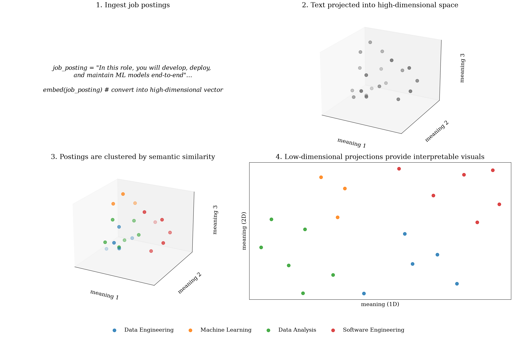

# Architecture

This section documents the system design of the Semantic Career Map: how the data pipeline is structured, why each design decision was made, and how data is laid out as the project moves toward a production, MLflow-tracked pipeline.

<!-- <div class="grid cards" markdown>

-   [**Design Decisions**](design-decisions.md){ .md-button }

    The seven deliberate trade-offs behind the pipeline — composable stages, dense embeddings, L2 normalization, precomputation, a stateless API, LLM extraction, and immutable experiment scripts.

-   [**Data Layout & Object Storage Naming**](data-layout.md){ .md-button }

    Lakehouse layout for raw postings, derived artifacts, and embeddings — content-addressed raw JSON, Parquet datasets, Hive-style partitions, Athena tables over the Glue catalog, and manifests for provenance.

</div> -->

---

## System Context

The Semantic Career Map is an information extraction and visualization system that transforms unstructured job postings into a structured semantic representation suitable for search, analysis, and career exploration. Job postings are processed through a multi-stage pipeline producing dense vector representations that capture semantic similarity between roles based on actual responsibilities rather than job titles.



---

## Pipeline

For a high level overview, the pipeline converts job postings into vectors so that structure can be analyzed using standard machine learning tools. 


```
┌──────────────────────┐
│    Raw Job Posting   │  (Markdown from LinkedIn/Various)
└──────────┬───────────┘
           ▼
┌──────────────────────┐
│    Data Ingestion    │  ✅ Built — Exp 001
└──────────┬───────────┘
           ▼
┌──────────────────────┐
│  LLM Text Extraction │  ✅ Built — Exp 003
│  (boilerplate removal│
│   + signal extraction)│
└──────────┬───────────┘
           ▼
┌──────────────────────┐
│ Semantic Partitioning│  ⚠️ Research — Exp 005
└──────────┬───────────┘
           ▼
┌──────────────────────┐
│  Taxonomy Labeling   │  ⚠️ Research — Exp 006
└──────────┬───────────┘
           ▼
┌──────────────────────┐
│ Embedding Generation │  ✅ Built — Exp 001
│  (L2-Normalization)  │
└──────────┬───────────┘
           ▼
┌──────────────────────┐
│   Vector Storage     │  ✅ Built — NumPy arrays
└──────────────────────┘
```

Each stage has a corresponding capability spec in `openspec/specs/` defining its requirements. Experiment numbers reference the validation artifacts — see [Experiment Log](../experiments/index.md).

As the pipeline is productionized, each stage's inputs and outputs move to versioned datasets in the S3 lakehouse and are tracked as MLflow runs. The lakehouse layout for that migration -- raw JSON layer, Parquet datasets, and Athena tables over the Glue catalog -- is defined in [Data Layout & Object Storage Naming](data.md).
