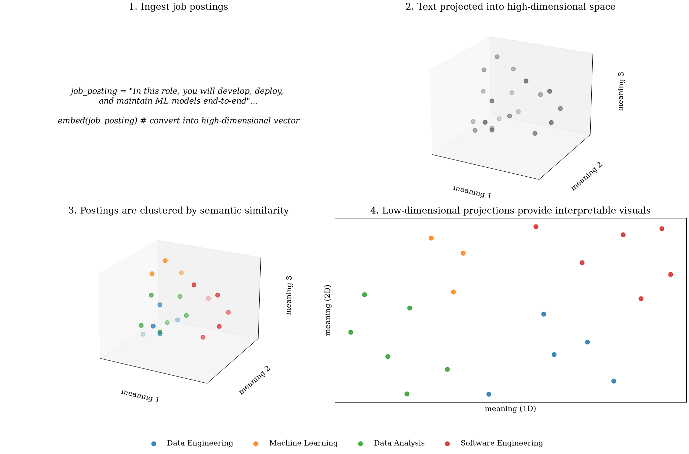
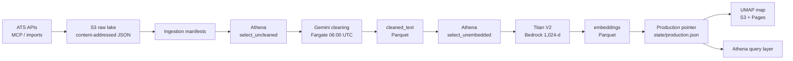

# Architecture

This section documents the production system: how postings move from source APIs into the S3 lakehouse, through cleaning and Titan V2 embedding, and out to the Athena query layer and interactive map. It also records the design decisions and migration history behind that layout.

## System Context

The Semantic Career Map is an information extraction and visualization system that transforms unstructured job postings into a structured semantic representation suitable for search, analysis, and career exploration. Job postings are processed through a multi-stage pipeline producing dense vector representations that capture semantic similarity between roles based on actual responsibilities rather than job titles.

## Pipeline

The conceptual flow is unchanged: ingest postings, clean them, embed them, reduce dimensions, and publish an interpretable map. The implementation is now a scheduled AWS pipeline rather than a local notebook flow.

| Stage | Current implementation | Status |
|---|---|---|
| Ingestion | ATS Lambda tier at 04:00 UTC; dataroles curator Fargate task at 05:00 UTC; HiringCafe MCP and LinkedIn import manual | ✅ Live |
| Raw storage | Content-addressed JSON under `lake/raw/source=.../sha256=...json`; one Parquet ingestion manifest per run | ✅ Live |
| Selection | Athena anti-join over the raw and artifact tables, bounded by recency and row count for scheduled runs | ✅ Live |
| Cleaning | Gemini 2.5 Flash Lite, exp-008 boilerplate-only prompt, buffered Parquet parts, artifact cache, fail-fast, run records | ✅ Live |
| Evaluation | Exp-003 metrics over a 39-reference golden set; manual gate before promoting a cleaning configuration | ✅ Implemented, manual |
| Embedding | Amazon Titan Text Embeddings V2 over Bedrock, 1,024-d, L2-normalized, scheduled at 07:00 UTC | ✅ Live |
| Version control | Stable-version claims, immutable `state/production.json` pointer, reconciliation of duplicate rows and orphan checkpoints | ✅ Live |
| Query | Glue tables over raw, cleaned, and embedding datasets; Athena workgroup with a 256 MiB scan cap | ✅ Live |
| Clustering | EVōC bake-off complete; Titan selected with its stability risk accepted | 🟡 Experimental |
| Visualization | UMAP cosine map, 2D Deck.GL view, 3D coordinates, lazy detail buckets | ✅ Titan V2 artifact published (10,010 postings) |
| Retrieval API | Resume/query endpoint and similarity search | 🔴 Not started |

Each stage has a corresponding capability spec in `openspec/specs/` defining its requirements. Experiment numbers reference the validation artifacts — see [Experiment Log](../experiments/index.md).

The lakehouse layout is defined in [Data Architecture](data.md). The step-by-step migration is recorded in the [AWS Migration Roadmap](aws-migration-roadmap.md), and the cleaning tier's implementation is in the [Cleaning Automation report](cleaning-automation-report.md).

## Production Control Plane

The pipeline does not expose a mutable "current" prefix. A run resolves its generation through `state/production.json`, which points at the cleaning tier and the ordered embedding entries. Stable embedding versions are claimed by exactly one configuration hash; a second configuration cannot silently join the prefix. This is what makes the switch from MiniLM to Titan V2 reversible without rewriting vectors.

## Not Yet Built

- FastAPI retrieval and resume-to-role search.
- A served clustering/label layer derived from the EVōC results.
- Automated map publication with generation/provenance checks.
- MLflow or an equivalent experiment-tracking server.
