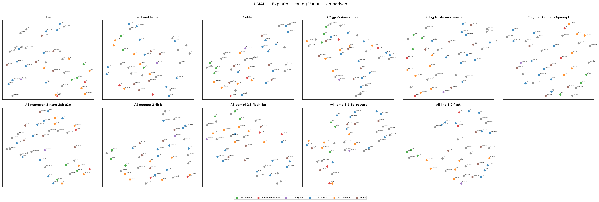

# Experiment 008 — Boilerplate-Only LLM Cleaning

**Date:** October 20, 2026

This experiment re-runs LLM job-posting cleaning with a corrected **boilerplate-only** prompt, tested on the full 39-posting corpus against a hand-curated golden set. It closes the loop that [Experiment 003](003-llm-extraction.md) opened: 003's extractive prompt stripped organizational/role context along with boilerplate (over-deletion 12.8–39.4% on golden postings), and [Experiment 005](005-semantic-partitioning.md) showed that retained role-context is the strongest clustering signal (golden role-context separation gap +0.0588, 8.5× raw). 008 asks whether a prompt redrawn around the *deletion boundary* fixes the damage without giving back the boilerplate removal.

## Experimental Design

Eight arms over 39 postings (27 migrated into `data/jobs.json` + 12 recovered from md-only files that the earlier migration never loaded), one pass each at temperature 0.0, non-streaming, through the Kilo Gateway:

| Arm | Model | Prompt |
|---|---|---|
| A1 | `nvidia/nemotron-3-nano-30b-a3b` | new (best 007 E2E latency) |
| A2 | `google/gemma-3-4b-it` | new (budget lane) |
| A3 | `google/gemini-2.5-flash-lite` | new (best consistency in 007) |
| A4 | `meta-llama/llama-3.1-8b-instruct` | new (cheapest) |
| A5 | `inclusionai/ling-3.0-flash` | new |
| C1 | `openai/gpt-5.4-nano` | new — 003's model with the corrected prompt |
| C2 | `openai/gpt-5.4-nano` | old — 003's prompt verbatim, reproducibility control |
| C3 | `openai/gpt-5.4-nano` | v3 — workpad-taxonomy prompt (see below) |

The A-roster is the top-5 latency/cost survivors from [Experiment 007](007-llm-latency-benchmark.md); the C-arms isolate the prompt effect on one model. Metric methodology — Jaccard vs golden, over-deletion `(golden − llm)/golden`, hallucination `llm_words − raw_words`, boilerplate marker scan — is ported verbatim from 003 so numbers stay directly comparable. The 003-era over-broad `about us.*mission|values|purpose` marker is excluded from the primary under-deletion signal because it false-positives on intentionally kept team-mission sentences.

### Three prompts, one ablation

**Old prompt (C2 control)** — 003's extractive contract: "Extract only the parts of a job posting that describe the job itself... Remove everything else," including team descriptions and mission statements. [This is the identified failure source.](003-llm-extraction.md#discussion)

**New prompt (C1/A-roster)** — redraws the boundary: "Remove only clearly non-job boilerplate... Keep everything that describes the job, the work, or the role's context within the organization." Generic company marketing becomes strippable while team descriptions are moved to the preserve list.

**v3 prompt (C3)** — distilled from the golden curation work itself. During 008's manual golden creation, the diff of what a human actually strips from real postings (≈1,175 deleted lines: compensation ≈51, benefits ≈66, EEO/accommodation ≈19, recruiter/process ≈28, perks/testimonials ≈13, location/hybrid ≈73, plus company marketing, pun headers, and job-board chrome like requisition ids, posted dates, and `#LI-*` tags) was categorized and folded back into the prompt. v3 adds explicit clauses for these classes — benefit plan names, pension/share-purchase/RRSP matching, LinkedIn tags, applied-date prompts, footer navigation text — and hardens the preserve list with the human-observed edge cases (hiring-level notes, program-role growth structure, clearance requirements, "why this might not be a fit" honesty sections, orphaned-header removal):

```
You are a job posting cleaner. Your only job is to remove text that is not about
this specific job, its team, or its work context. When unsure, keep the text.

[full text in scripts/008_boilerplate_only_cleaning/prompts.py — V3_SYSTEM_PROMPT]
```

### Golden set: the workpad flow

Curation of 34 postings via the 003-style interactive CLI loop proved infeasible, so the flow was redesigned: raw text for all 39 postings was staged in a workpad (`scripts/008_boilerplate_only_cleaning/data/008_golden_workpad.md`), stripped in place, finalized in a user-side diff review, then ported mechanically into `data/golden_cleaned.json` by `pad_to_golden.py`. The pad **is** the sign-off record; the port script is dry-run by default and never overwrites an existing golden entry. Golden coverage: 39/39 postings (up from 5 in 003). The strip taxonomy from this review is what the v3 prompt encodes — curation and prompt tuning closed their loop.

## Results

Each arm ran once per posting; `MiniLM-L6-v2` evaluated the downstream embedding quality of every variant. 310 (arm, posting) rows scored against the golden set.

### Text fidelity per arm

| Arm | Model | n | Jaccard | Over-deletion | >5% flagged | Halluc. | Boilerplate-hit postings | $/post |
|---|---|---|---|---|---|---|---|---|
| C2 | gpt-5.4-nano | 39 | 0.765 | **22.8%** | 32 | 0.1 | 3 | $0.00042 |
| C1 | gpt-5.4-nano | 39 | 0.826 | **2.3%** | 5 | 0.0 | 12 | $0.00057 |
| C3 | gpt-5.4-nano | 39 | 0.858 | 5.2% | 10 | 0.0 | 14 | $0.00057 |
| A1 | nemotron-3-nano-30b-a3b | 39 | 0.815 | 3.8% | 11 | 0.6 | 9 | $0.00019 |
| A2 | gemma-3-4b-it | 39 | 0.804 | 13.3% | 21 | 2.3 | 11 | $0.00008 |
| A3 | gemini-2.5-flash-lite | 39 | **0.894** | 4.0% | 8 | 0.1 | 7 | $0.00036 |
| A4 | llama-3.1-8b-instruct | 39 | 0.871 | 8.9% | 21 | 1.2 | 7 | $0.00004 |
| A5 | ling-3.0-flash | 37 | 0.847 | 10.0% | 13 | 0.8 | 8 | $0.00036 |

- **C2 reproduces the 003 failure mode at scale.** 22.8% mean over-deletion with 32 of 39 postings above the 5% flag threshold — exactly the aggressive-strip behavior that motivated this experiment, now confirmed on curated golden texts. Its mean output is 293 words vs the alternatives' 374–477: the old prompt simply deletes less text because it deletes too much.
- **C1 vs C3 is the prompt-length trade.** The new prompt nearly eliminates over-deletion (2.3%) but under-deletes: boilerplate-market text survives in 12 postings (outputs pay for it in Jaccard, 0.826). The v3 taxonomy prompt buys back some deletion (5.2%) and Jaccard rises to 0.858 with zero-mean hallucinations — but under-deletion is slightly *worse* by marker count (14 vs 12 postings): more deletion invites more residue.
- **Where v3 over-deletes, it over-deletes like C2.** Its worst rows — motion-recruitment-ml-engineer (47.6%), cerebras-ml-performance-benchmarking-engineer (41.2%), tactable-data-engineer (23.0%) — carry recruitment-flavored and marketing-heavy copy whose team paragraphs read like advertising; v3's tightened marketing clauses strip them. The marketing-vs-team-context boundary remains the open problem, now with named instances.
- **A3 (gemini-2.5-flash-lite) is the best arm overall** — highest Jaccard (0.894), 4.0% over-deletion, near-zero hallucinations, cheapest A-roster option that leads its tier. Nemotron runs cheapest-per-quality among open models.
- **A5 faulted and is not deployable as-is.** 3 postings (`cibc-quantitative-analyst`, `pinterest-ml-engineer-2`, `td-applied-ml-scientist-graduate`) returned empty responses across repeated attempts, and most successful outputs saturate the 2048-token ceiling — truncation risk that inflates its under-deletion profile.

### C2 reproducibility

Reruns are **not** byte-stable through the gateway at temperature 0.0: only 8 of 27 comparable postings reproduce 003's published `llm_clean_text` byte-for-byte (Jaccard-to-003-output spans 0.753–1.000). The effect is small relative to the prompt deltas above, but it means prompt-generation experiments should not rely on byte-exact references — treat 003-era numbers as one sample from a distribution.

### Embedding comparison

| Variant | Self-Retrieval | Separation Gap | Mean CosSim | Max CosSim |
|---|---|---|---|---|
| Raw | 100.0% | +0.0060 | 0.4132 | 0.9228 |
| Section-Cleaned | 100.0% | +0.0203 | 0.4305 | 0.8775 |
| Golden | 100.0% | +0.0657 | 0.4996 | 0.9849 |
| C2 (old prompt) | 100.0% | +0.0437 | 0.5337 | 0.9260 |
| C1 (new prompt) | 100.0% | +0.0280 | 0.4452 | 0.9499 |
| C3 (v3 prompt) | 100.0% | +0.0351 | 0.4709 | 0.9839 |
| A3 (best arm) | 100.0% | +0.0769 | 0.4827 | 0.7933 |
| A5 (best gap) | 100.0% | +0.0813 | 0.4653 | 0.8829 |



- Golden separation gap is **11× raw** (+0.0060 → +0.0657) on the 4× larger labeled corpus — consistent with 003's 8.2× at n=27/5 golden.
- **Aggressive, *faulty-but-consistent* cleaning can beat golden separation.** A5 and A3 (+0.0813, +0.0769) exceed the golden gap itself: deleting shared boilerplate uniformly concentrates whatever role signal survives, even when role-context is lost in individual postings. Separation gap alone cannot rank these arms — text fidelity does not correlate with this proxy here, and both must be read together.
- The prompt-ablation trio shows the same tension one dimension smaller: C2's stripped-down text separates best of the three (+0.0437) while holding the worst fidelity; C1 keeps the most text and separates worst (+0.0280); C3 lands between (+0.0351).

## Discussion

- The experiment thesis holds at scale: **the prompt is the failure source, and fixing it fixes the metric.** One model changed its over-deletion profile from 22.8% to 2.3–5.2% purely on prompt text, with zero hallucinations in all three C-arms.
- The curation red-line did the real work. A hand-annotated 39-posting golden set — built via the workpad flow in a single user review pass — turned "is the output plausible?" into measurable over-deletion/under-deletion rows with named failure instances per arm. The interactive-draft loop it replaced produced 4 sign-offs in its lifetime.
- The v3 prompt is the first prompt in this repo **derived from measured human strip behavior** rather than composed from intuition. It moved gpt-5.4-nano from Jaccard 0.826 → 0.858; its residual over-deletion rows (motion-recruitment, cerebras) are targeted, explainable cases, not nonsense — the marketing/team boundary is truly ambiguous there.
- Fault classes transfer models: `empty response` on ling-3.0-flash is reproducible on specific postings (non-streaming!), contradicting the 007 round-2 finding that the class is streaming-only — it is posting-content-dependent for some gateways. An arm that systematically cannot complete is a recorded fault, not a run crash.
- Ops lesson captured in code: two concurrent extractor processes corrupted the shared append-only cache (torn/concatenated JSON). The cache writer is now atomic (temp-file + `os.replace`) and the runner takes an exclusive `flock`; a 226-entry salvage showed byte-intact entries in both halves.

## Limitations

- 12 of 39 postings are md-only and role-unlabeled; separation gap remains computed on the labeled 27, with role-heavy classes keeping formal significance testing weak. Metrics are comparative.
- Self-retrieval saturated at 100% everywhere at n=39 — the degeneracy check has lost discriminating power at this corpus size.
- A5 is missing 3 golden rows and truncation-saturated; its rows understate both fidelity and cost.
- Over-deletion flags inherit 003's >5% heuristic; each flag was reviewed against the unambiguous marker set rather than machine-judged.
- v3 fallback pricing: gpt-5.4-nano priced from 003's table ($0.15/$0.60 per 1M tokens) with other models from 007's frozen probe (2026-10-17).

## Conclusions

1. **Boilerplate-only prompts work.** The corrected prompt family eliminates the over-deletion failure while preserving hallucination-free output.
2. **Deploy recommendation: `gemini-2.5-flash-lite` with the new prompt** (Jaccard 0.894, 3.994% over-deletion, $0.00036/posting) — best fidelity and best leader of 007's consistency ranking, at mid-tier cost. `nemotron-3-nano-30b-a3b` is the cheapest alternative with acceptable fidelity.
3. **Prompt iteration should be feedback-driven.** v3 outperformed the composed prompt on the deployed model; the next version should target the three named over-deletion postings' copy patterns.
4. **Separation gap and text fidelity must be read jointly** — they moved inversely across the ablation, which is exactly why two metric families exist.

## Next Steps

- Migrate the 12 md-only postings' role labels into `jobs.json` (unblocks n=39 separation gap).
- Track the `empty response` fault class to posting content and gateway route drift — re-verify ling survivors before considering it for latency vs quality trade-offs.
- Prompt v4: strip boundary cases from the motion-recruitment/cerebras/tactable class; evaluate whether marking team paragraphs as "preserve if factual" fixes v3's worst rows.
- Re-run semantic partitioning (Exp 005 prompts) on the corrected cleaned text — the job/role partitions were built on over-deleted bases.
- Feeding cleaned text into the Phase 2 feature-engineering panel (skill extraction, weighted concatenation, golden `pytrec_eval`).
