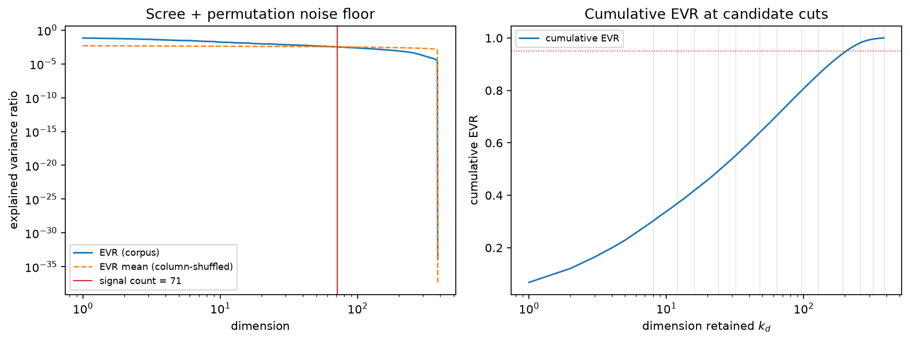
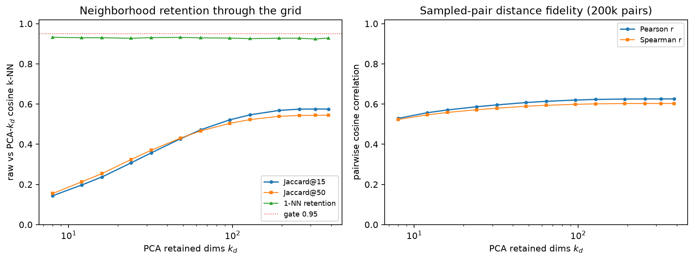

# Experiment 009 — PCA Informativeness Benchmark

**Date:** October 29, 2026

**Status:** Design approved and preregistered; first corpus-wide run recorded **2026-10-29** — see [Results](#results). Per the immutable-scripts rule, the harness under `scripts/009_pca_informativeness/` is frozen as a record of what was run.

**Hypothesis:** The production embedding corpus (9,354 × 384, all-MiniLM-L6-v2, L2-normalized) has an effective intrinsic dimension far below 384, so PCA pre-reduction to `k_d` ≪ 384 — rung 1 of the UMAP scaling ladder in [Report 022](../research-reports/022-umap-cloud-scale-deployment.md) — preserves cosine neighborhood structure at the granularity UMAP's k-NN phase consumes, at an 8× reduction of the dominant distance cost. Concretely: a linear-spectrum and neighborhood-retention benchmark can name the smallest safe `k_d`, and report 022's "~50 dims" estimate is a testable hypothesis, not an assumption.

## Motivation

Report 022 establishes the scaling path for the job-map deliverable: UMAP projection is the memory bottleneck, the CPU mitigation ladder's lever 4 is PCA pre-reduction before UMAP, and §7's near-term action 3 is to make that reduction a flag with a measured default. The probe (`scripts/map_umap_probe.py`) currently projects the full 9,354-row corpus in 384-d space; the sampling manifests point the pipeline toward 10⁵–10⁶ postings, where k-NN distance cost in `d` dimensions becomes the dominant CPU expense. Half of the ladder's rung-1 value hinges on a number that has not been measured on this corpus: how many dimensions actually carry structure. Sentence-embedding spectra are known to be anisotropic and low-effective-rank, but "known in the literature" is exactly what this project replaces with a local measurement before the number becomes a default (`n_dims`) in `scripts/map.py` when the spike graduates.

The experiment also serves report 021's distance-concentration concern: if PCA cuts dimensionality, the question is not just "how much variance survives" but "does neighbor-vs-random distance contrast survive" — the quantity k-NN graphs actually consume. And it feeds forward: a second experiment (010, UMAP subsample-fit stability, sketched in the [post-script](#post-script-experiment-010-umap-subsample-fit-vs-full-stability) below) needs 009's `k_d*` to define its reduced input space. Like-for-like precedent for protocol style (frozen config, raw JSONL artifacts, no inferential statistics) follows [Experiment 007](007-llm-latency-benchmark.md).

## Experimental Design

### Data and input contract

- **Corpus:** `semantic_career_map.postings_embeddings`, `configuration_hash = a29a35e37a0d7025a961b5241ff278904500ed43edf022ac7304dacdb97e0c98`, 9,354 rows, `ORDER BY source_hash` prefix contract — identical fetch SQL to `map_umap_probe.fetch_vectors`, deterministic, every run a prefix of any larger run.
- **Matrix:** `(9354, 384)` float32, L2-normalized as stored; row identity = `source_hash`.
- **Cache:** first fetch persists `vectors_cache.npy` (+ hashes JSON) beside the harness so reruns and the analysis pass are offline; the cache is not committed (14.4 MB binary, repo rule).
- **Columnstore off:** measurement runs on the full 9,354 rows — at this size the exact computations are cheap and there is no sampling noise in the primary read.

### Core trick — one SVD, every truncation free

All PCA truncations are slices of one thin SVD of the centered matrix:

```python
Xc = X - X.mean(axis=0)
U, S, Vt = np.linalg.svd(Xc, full_matrices=False)
X_k = U[:, :k] * S[:k] @ Vt[:k]    # any k on the grid, ~free
```

The only per-`k_d` cost is cosine k-NN in `X_k`: one `X_k_norm @ X_k_norm.T` matmul (9,354² float32 ≈ 350 MB transient) followed by `argpartition` top-15. No incremental PCA, no randomized solvers — thin SVD is exact and takes seconds at n=9.4k, d=384.

### Implementation Note

Core metrics need **NumPy only** (`numpy 2.5.3` already in `.venv`) — no scikit-learn in this experiment's path, no new dependencies of any kind. Falls out naturally because PCA here is an explicit SVD rather than `sklearn.decomposition.PCA`, and "ground truth" k-NN is exact matmul, not an ANN index.

### Candidate grid

`k_d ∈ {8, 12, 16, 24, 32, 48, 64, 96, 128, 192, 256, 320, 384}` — dense below 128 (the decision zone), coarse above, 384 reserved as the no-reduction control. The permutation-informed signal count (below) is added to the grid as a computed point.

### Metrics — four families

**A — Spectrum (computed once).**

- Eigenvalue spectrum `λᵢ` (from `S²`), explained-variance ratio, cumulative EVR, scree elbow.
- **Participation ratio** `PR = (Σλᵢ)² / Σλᵢ²` — the headline "effective dimensionality" number.
- **Permutation noise floor (signal count):** 10 replicas with each column independently shuffled (seed 42) → SVD per replica → dims whose EVR exceeds the mean permuted EVR = signal dimensions. This names "informative" without an arbitrary variance threshold.

**B — Cosine neighborhood retention (primary decision metric, per `k_d`).**

- **Ground truth:** exact cosine 15-NN per point in the original 384-d space — matching the pinned UMAP probe parameters (`n_neighbors=15, metric="cosine"` in `map_umap_probe.py`). Exact, not pynndescent: an approximate reference would poison retention deltas.
- Per `k_d`, exact cosine 15-NN in `X_k` space, then:
  - **mean Jaccard@15** across points (primary read);
  - **1-NN retention rate** (% of points whose single nearest neighbor is preserved);
  - **mean rank displacement** of original 15-NNs in the reduced ordering.
- Secondary read at k=50 for robustness away from the probe's exact setting.

**C — Distance fidelity on sampled pairs (per `k_d`).**

- 200,000 sampled point pairs (seed 42): Pearson r and Spearman r between original-space cosine and `X_k`-space cosine; MAE.
- **Contrast ratio:** `mean(cos to 15-NN) / mean(cos to random 1% of points)`, original vs reduced — the distance-concentration survival check (Report 021 §2); without contrast, ranks can hold while k-NN geometry degenerates.

**D — Label-anchored check (secondary, low weight).**

- Separation gap (`technical/evaluation.md`) in original vs `X_k` space. Caveat recorded up front: role labels (`data/006_taxonomy_labels.json`, golden set) cover 27 postings keyed by `posting_id`, not the 9,354 corpus — this is a directional check on labeled points only and never gates the decision.

### Pre-registered decision rule

Recorded before the run:

- **`k_d*` = smallest `k_d` meeting both:** (1) mean Jaccard@15 ≥ 0.95 against the exact original-space cosine 15-NN, and (2) `k_d` ≥ the permutation-informed signal count.
- No `k_d ≤ 96` clears the bar → **PCA pre-reduction is rejected over this range**; the decision section reports the full control sweep and revisit notes (e.g. whiten or per-source normalization variants), and report 022's rung-1 default stays unset (`n_dims=None`) rather than guessed.
- Associated pre-registrations, falsifiable on their own terms (all three share the same run):
  - H1 (spectrum): PR lands in 48–96 with cumulative EVR ≥ 0.95 within 96 dims.
  - H2 (neighborhoods): a `k_d ≤ 64` obeys Jaccard@15 ≥ 0.95.
  - H3 (noise floor): signal count lands in 40–110.
- Outcomes slot directly into report 022's ladder: `k_d` default (e.g. whether '~50' survives contact with the production corpus), no-reduction fallback threshold, and the measured cosine distance cost saving behind the 8× estimate.

### Notes and caveats

1. **Centering shifts cosine geometry.** The vectors are L2-normalized; PCA centers, moving points off the unit sphere. The retained comparison — `X_k`-cosine 15-NN against *original-space* cosine 15-NN — is exactly the deployment question (`X → PCA(k) → UMAP(cosine)` vs `X → UMAP(cosine)` directly), not an abstract reconstruction score. Logged for the decision: this encodes centering in the answer.
2. **Reconstruction error would be redundant.** Relative Frobenius error equals `1 − cumulative EVR` for truncated SVD; family A already carries identity-correct reconstruction information, no separate metric.
3. **No whiten.** Downstream geometry is cosine; whitening distorts scale structure and adds nothing at Jaccard@15 measurement. Rejected here precisely so the deployment question dominates.
4. **Determinism envelope.** SVD and k-NN are deterministic; stochasticity confined to pair sampling (C), random-other sampling for the contrast ratio (C), and permutation shuffling (A), implemented as three reproducible seed substreams derived from 42 (permutation 42, pairs 43, random-others 44) so interrupted/staged runs remain bit-reproducible (refinement recorded 2026-10-29, before first run). Frozen config header stored in `scripts/009_pca_informativeness/data/009_config.json` (report 022's `CONFIGURATION_HASH`, row count, grid, thresholds, seeds, git commit) per the Experiment 007 protocol.
5. **Why exact NN as reference.** There is no approximate index in this path; at 9,354² exact distance blocks fit transiently and imply zero variance in the reference signal — the retention read must not require interpreting ANN recall.
6. **Resource envelope.** Peak RSS < ~1 GiB, one exact k-NN pass per 13 grid points + 384-pass, full runtime ≲ 5 minutes on the local 23 GiB / 12-core box; BLAS-threaded matmuls only, no pynndescent, no `n_jobs` tuning required.
7. **Immutability and graduation path.** Harness standalone: no `backend/` imports; frozen after first recorded run. If retained dimensionality code survives into production later, it is extracted into `backend/pipeline/` when the map spike graduates to `scripts/map.py` (report 022 §7.1), per the immutable-scripts rule.

## Artifacts

| Artifact | Path | Committed |
|---|---|---|
| Runner (fetch → SVD → metrics) | `scripts/009_pca_informativeness/run_benchmark.py` | yes |
| Analyzer (tables, plots) | `scripts/009_pca_informativeness/analyze_results.py` | yes |
| Frozen config header | `scripts/009_pca_informativeness/data/009_config.json` | yes |
| Vectors cache + hashes | `scripts/009_pca_informativeness/data/vectors_cache.npy` | no (14.4 MB binary) |
| Raw per-`k_d` metric rows | `scripts/009_pca_informativeness/data/009_raw_results.json` | yes |
| Canonical results summary | `data/009_pca_benchmark.json` | yes |
| Plots | `docs/experiments/assets/009_scree.png`, `docs/experiments/assets/009_retention_curve.png` — colocated with this page (user decision 2026-10-29), embedded below | yes (small PNGs) |
| Report | this page; Results recorded 2026-10-29 | yes |

## Results

**First run: 2026-10-29** — cache/fetch 12.6 s, SVD 4.4 s, permutation floor 30.7 s, retention ladder 73.3 s, fidelity 10.7 s (~94 s total, comfortably inside the resource envelope). Raw stage payloads in `scripts/009_pca_informativeness/data/009_raw_results.json`; canonical summary in `data/009_pca_benchmark.json`.

**TL;DR:** the pre-registered decision rule returns **`k_d* = None`** — no candidate clears Jaccard@15 ≥ 0.95, and the control column proves why the ladder cannot: PCA's centering shift alone (k_d = 384, zero truncation) turns over 42.5% of cosine 15-NN neighborhoods against the original-space ground truth. Dimension loss on top of that ceiling is modest; the two effects were both measured separately, as designed.



### Spectrum (family A)

- **Participation ratio 57.6** — H1's PR band (48–96) confirmed; effective dimensionality is far below 384, but nowhere near the folklore "~50".
- **Signal count 71** (EVR above the mean 10-replica column-shuffled noise floor) — H3's band (40–110) confirmed. This is the defensible "informative dimensions" number.
- **Cumulative EVR** climbs slowly: 0.55 at 32, 0.70 at 64, 0.80 at 96, 0.86 at 128, 0.94 at 192, 0.98 at 256. The 0.95 line is crossed only past ~192 dims — H1's EVR clause rejected.
- **No interior scree knee**: the chord method places the knee at dim 381 — the log-EVR curve declines smoothly, so elbow folklore does not apply to this spectrum. The permutation floor (71) is the honest cut, not a visual kink.

### Retention and fidelity (families B + C, joined)



| k_d | Jaccard@15 | Jaccard@50 | 1-NN rate | mean disp@15 | Pearson r | Spearman r | MAE | gate |
|---|---|---|---|---|---|---|---|---|
| 8 | 0.1439 | 0.1549 | 0.9325 | +276.6 | 0.5288 | 0.5234 | 0.4625 | . |
| 12 | 0.1969 | 0.2126 | 0.9299 | +161.7 | 0.5568 | 0.5462 | 0.4470 | . |
| 16 | 0.2373 | 0.2543 | 0.9301 | +111.3 | 0.5708 | 0.5584 | 0.4407 | . |
| 24 | 0.3070 | 0.3239 | 0.9273 | +65.0 | 0.5865 | 0.5716 | 0.4360 | . |
| 32 | 0.3576 | 0.3707 | 0.9306 | +44.4 | 0.5959 | 0.5794 | 0.4344 | . |
| 48 | 0.4269 | 0.4303 | 0.9319 | +26.0 | 0.6075 | 0.5891 | 0.4334 | . |
| 64 | 0.4721 | 0.4664 | 0.9295 | +18.3 | 0.6136 | 0.5938 | 0.4329 | . |
| 96 | 0.5213 | 0.5039 | 0.9283 | +12.2 | 0.6200 | 0.5987 | 0.4326 | . |
| 128 | 0.5464 | 0.5229 | 0.9256 | +9.9 | 0.6230 | 0.6011 | 0.4325 | . |
| 192 | 0.5683 | 0.5389 | 0.9277 | +8.3 | 0.6249 | 0.6024 | 0.4324 | . |
| 256 | 0.5747 | 0.5432 | 0.9277 | +8.0 | 0.6255 | 0.6029 | 0.4323 | . |
| 320 | 0.5751 | 0.5442 | 0.9235 | +7.9 | 0.6256 | 0.6029 | 0.4323 | . |
| **384 (control)** | **0.5752** | 0.5444 | 0.9289 | +7.9 | **0.6256** | 0.6029 | 0.4323 | . |

### The centering ceiling (the finding this design was built to expose)

1. **At zero truncation** (k_d = 384), the reduced space is the *centered* corpus — and against original-space cosine 15-NN ground truth it scores Jaccard 0.575, Pearson 0.626, MAE 0.432. **PCA centering moves points off the L2 sphere, and the ORIGINAL cosine geometry does not survive the frame shift**: ~42.5% of 15-NN sets and ~7% of 1-NN relations turn over from centering alone. This was flagged in Notes #1 as "this encodes centering in the answer" — the control column now quantifies it.
2. **Truncation damage on top of the ceiling is small and flattening**: relative to the 0.5752 ceiling, k_d = 128 keeps 95% of surviving neighborhoods (0.5464/0.5752), k_d = 192 keeps 98.8%; mean rank displacement stabilizes ≈ +8 positions beyond 128.
3. **1-NN retention is flat (~0.93) across the whole grid including 384** — the frame shift flips one-in-fifteen nearest neighbors regardless of truncation.
4. **Neighbor-vs-random contrast explodes in reduced centered spaces** (ratio 389×–575× at 8–64 dims vs the original 1.76): centering squeezes random-pair cosines toward a newly-origin-centered mean, expanding contrast. Helpful for k-NN graph construction if the centered frame is accepted — recorded as an artifact of centering, not a fidelity gain.

### Decision (pre-registered rule, applied verbatim)

- **`k_d* = None`** (gate = Jaccard@15 ≥ 0.95 AND k_d ≥ 71; nothing clears). Pre-registered consequence: PCA pre-reduction is rejected over this range, and report 022's rung-1 `n_dims` default stays unset rather than guessed. Report 022 §7 action 3 stays OPEN, now carrying measured evidence instead of an assumption.
- H1: half-confirmed (PR ✓ in band; EVR-at-96 clause ✗). H2: rejected (no k_d ≤ 64 clears 0.95 — none anywhere). H3: confirmed (71 ∈ 40–110).
- The control column reframes the rejection rather than settling the strategy: the preregistered gate measures *centered-frame* fidelity against the *original* frame, but the actual deployment would run PCA and UMAP **entirely inside the centered frame**. Inside that frame, PCA-128 retains ~95% of full-rank centering neighborhoods at a 3× k-NN distance-cost reduction, and the flat 1-NN row says truncation adds almost nothing to centering's own turnover.

### Follow-up proposals (amendments — not adopted without approval)

Since the harness is frozen and the first run recorded, any revision is a new artifact plus an explicit amendment note appended here:

1. **Centered-frame variant** — ground truth = cosine 15-NN of the centered full-rank space (the deployment frame); identical grid and gates. Expected effect: the ceiling becomes 1.0 and the gate can actually separate candidates.
2. **Uncentered truncation (LSA-style)** — thin SVD of X *without* mean subtraction (variant: top-k singular triplets of the uncentered matrix). For points on a sphere with a non-zero mean, this preserves original cosine geometry better than centered PCA; it is the standard truncation used in text retrieval (LSA), and cheap to test in the same harness shape.
3. Whichever variant clears its gate feeds report 022's rung-1 default and the subsample experiment (010) unchanged.

## Post-Script — Experiment 010 (UMAP Subsample-Fit vs Full Stability)

Second half of the visualization-tools workstream, sketched now, finalized after 009 because `k_d*` defines its input space. Design pending 009's results.

- **Preregistrable question**: UMAP fitted on subsample m ≪ n (optionally + `transform` of the tail) equals full-fit map quality at what m — supporting the fit-subsample-then-transform strategy pre-registered as rung 2 of report 022's ladder, and validating the same-seed estimation of coordinator cost pairs.
- **Reference arm:** full 9,354-row UMAP, probe parameters pinned (`n_neighbors=15, min_dist=0.1, metric="cosine", random_state=42, low_memory, n_jobs=1`).
- **Treatment arms:** sample-size ladder m ∈ {500, 1000, 2000, 4000} × 5 seeds, two variants per m — fit-only, and fit + `transform(remainder)` (report 022 §4.5 near-term action 4).
- **Metrics, alignment-free wherever possible** (UMAP coordinate frames are non-comparable across runs, so compare distance geometry, not coordinates): (a) `sklearn.manifold.trustworthiness` of each 2D layout against original cosine k-NN (needs sklearn — already in `.venv` — but no new dependency); (b) cross-seed stability — Spearman correlation of shared-point 2D distance matrices within an m; (c) subsample-vs-full agreement — same correlation on shared points; (d) optional HDBSCAN cluster-count preservation on layouts.
- **Readout:** minimum m where (a) matches full fit and (b) plateaus → rung-2 subsample default; 009's `k_d*` fixes the input space and makes the two experiments a single compositional claim: `fit UMAP on PCA-reduced subsample of size m`.

## References

- [Report 022 — Scaling UMAP to Cloud Hardware](../research-reports/022-umap-cloud-scale-deployment.md) — rung-1 mitigation ladder this experiment measures §4 lever 4, §7 action 3.
- [Report 021 — Clustering Metrics at Scale](../research-reports/021-clustering-metrics-at-scale.md) — distance-concentration background behind the contrast-ratio metric.
- [Report 020 — Job Map Visualization Tools](../research-reports/020-job-map-visualization-tools.md) — deliverable context for the projection pipeline.
- [`technical/evaluation.md`](../technical/evaluation.md) — separation gap and self-retrieval definitions (family D).
- [Experiment 007](007-llm-latency-benchmark.md) — protocol precedent: frozen config header, raw JSON artifacts, no inferential statistics.
- `scripts/map_umap_probe.py` — pinned UMAP parameters (n_neighbors=15, cosine, seed 42) and the input-contract SQL reused verbatim.
