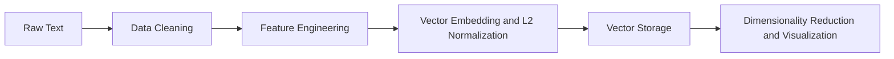

# Embedding Pipeline

## Overview

The embedding pipeline converts cleaned job posting text into dense 1,024-dimensional vector representations suitable for semantic similarity search. The live production generation is normalized **Amazon Titan Text Embeddings V2** (`amazon.titan-embed-text-v2:0`, called through Bedrock); the earlier `all-MiniLM-L6-v2` 384-d generation remains on disk as the rollback target. The pipeline's stages -- anti-join delta selection, encode, L2 normalization, Parquet parts under a model-first partition -- do not depend on which model fills the encode step.



## Preprocessing

### Text Normalization

- Whitespace collapsing: multiple spaces, tabs, and newlines reduced to single spaces
- Unicode normalization: NFKC normalization for consistent character encoding
- Case preservation: both production encoders (`all-MiniLM-L6-v2` and Titan V2) are trained on cased text — lowercasing is skipped

### Boilerplate Removal

Non-essential content is removed using LLM-based extraction (gpt-5.4-nano). The system prompt instructs the model to strip company descriptions, salary ranges, benefits, EEO statements, and recruiter notes — while preserving job duties, technical skills, and qualifications verbatim.

This approach replaced brittle regex-based cleaning (Experiment 002) with a more robust method (Experiment 003) that achieved an 8.2× improvement in separation gap over raw text.

!!! info "LLM Extraction Results"
    Zero hallucinations across 5 gold-standard postings. Zero boilerplate detected. Over-deletion of organizational context (19–39%) is the primary area for improvement.

### Skill Extraction (Planned)

A curated vocabulary of ~200 ML/DS/AI domain terms will be extracted using spaCy `PhraseMatcher`:

- Languages: Python, R, SQL, Scala, Java, C++
- ML Frameworks: PyTorch, TensorFlow, JAX, scikit-learn, XGBoost, Transformers
- ML Techniques: Deep Learning, Reinforcement Learning, NLP, Computer Vision, Generative AI, LLM
- Infrastructure: AWS, GCP, Azure, Docker, Kubernetes, MLflow, Spark, Airflow

## Embedding Model

### amazon.titan-embed-text-v2:0 (production)

| Property | Value |
|---|---|
| Provider | Amazon Bedrock (`bedrock-runtime` `InvokeModel`, region-local) |
| Model ID | `amazon.titan-embed-text-v2:0` (the config's `model_revision`) |
| Dimensions | 1,024 (requested explicitly: `"dimensions": 1024`) |
| Normalization | Native (`"normalize": true`); the client re-asserts unit norm at 1e-5 |
| Input bound | 8,192 tokens — enforced per response, never silently truncated |
| Request shape | one `InvokeModel` per text, serial, retried on throttling/5xx/timeouts |
| Output geometry | `float32 (N, 1024)`, unit rows |

Implementation: `backend/pipeline/embedding/titan.py` (`TitanEncoder`), selected by
`build_encoder` from the config's `model_name` family. The request contract, token
bound, and latency measurements come from
[experiment 011](../experiments/011-encoder-coverage-bakeoff.md); 012 chose this
generation for production over the MiniLM baseline.

Per-row postconditions mirror the sentence-transformers path: a zero vector, a
wrong width, a token count above `max_length`, an embedding that does not
normalize to within 1e-5, or a deterministic Bedrock fault (`AccessDenied`,
`ValidationException`, model-access) fails the batch immediately — the driver
re-raises with the batch index and first `source_hash`. Transient faults
(throttling, 5xx, connection errors) retry with capped exponential backoff; the
encoder stays serial because experiment 011's first concurrent pass stalled at
125 rows.

### all-MiniLM-L6-v2 (rollback generation)

| Property | Value |
|---|---|
| Architecture | 6-layer MiniLM (distilled from BERT) |
| Dimensions | 384 |
| Model size | ~80 MB |
| Training data | 1B+ sentence pairs |
| Optimization target | Semantic similarity |
| Default pooling | Mean pooling with attention mask |
| Inference speed | ~20 ms per posting (CPU) |
| Context window | 256 tokens |

Still baked into the embed image and listed second in the production pointer, so
rolling back is a pointer flip, not a rebuild. Its vectors are untouched by the
Titan runs (versions add, never overwrite).

### Model Selection Rationale

| Model | Dimensions | Size | CPU Latency | Selected? |
|---|---|---|---|---|
| amazon.titan-embed-text-v2:0 | 1,024 | managed (Bedrock) | ~0.56 s per request (p90 1.31 s), serial | ✓ production |
| all-MiniLM-L6-v2 | 384 | 80 MB | ~20 ms | rollback |
| bge-small-en-1.5 | 384 | 133 MB | ~28 ms | |
| mpnet-base-v2 | 768 | 438 MB | ~40 ms | |

The original local-only choice was a single model, deliberately, to reduce scope
while feature engineering settled. Experiment 011 then measured full-corpus
encoder coverage including Titan, and experiment 012 measured downstream
clustering stability; normalized Titan V2 was approved for production on
2026-10-31 with its stability risk recorded, not resolved.

## Post-Processing

### L2 Normalization (Critical)

Every vector is normalized to the unit sphere after embedding. This is the single most impactful post-processing step.

```python
def l2_normalize(vecs: np.ndarray) -> np.ndarray:
    norms = np.linalg.norm(vecs, axis=1, keepdims=True)
    return np.where(norms > 0, vecs / norms, vecs)
```

After normalization, cosine similarity reduces to dot product — the fastest similarity metric. It also prevents magnitude imbalance where longer documents rank above short but highly relevant ones. Applied at both write time (indexing) and query time.

!!! warning "Verify Normalization"
    Library defaults vary. `sentence_transformers` normalizes only with
    `normalize_embeddings=True`; Titan normalizes only when the request body says
    `"normalize": true`. Both encoders enforce the 1e-5 postcondition and raise
    instead of writing a non-unit row.

### Mean Centering (Planned)

Subtract the training-set mean from all vectors. Reduces dominance of common boilerplate directions in the embedding space. The mean must be computed on the training split only and applied identically to all other data.

### PCA Whitening (Deferred)

Rotates embeddings into principal-component space and divides by sqrt variance. Deferred due to poor sample-to-dimension ratio (27 samples vs 384 dimensions — whitening amplifies noise in low-variance components). Safer variant planned: top-k components with shrinkage regularization.

## Implementation

The driver (`backend/pipeline/embedding/driver.py`) is model-agnostic: it streams
`(source_hash, text)` rows from the anti-join, slices them into `batch_size`
windows, and hands each window to whichever `EmbeddingEncoder` the config
selected. `build_encoder` (`backend/pipeline/embedding/encoder.py`) dispatches by
model family — Titan to the Bedrock encoder, everything else to the pinned
sentence-transformers load.

```python
# backend/pipeline/embedding/encoder.py
def build_encoder(config: EmbeddingConfig) -> EmbeddingEncoder:
    if is_titan_model(config.model_name):
        return TitanEncoder(config)   # backend/pipeline/embedding/titan.py
    return SentenceEncoder(config)
```

```python
# backend/pipeline/embedding/titan.py (per-text request body)
{"inputText": text, "dimensions": 1024, "normalize": True}
```

Provenance is unchanged by the model switch: the config's `model_name` /
`model_revision` pair feed the row's `model` / `model_version` columns, the part
key's `model=` partition, and the dataset manifest — they now carry a Bedrock
family id and model ID instead of a HuggingFace id and commit.

## Section Weighting Strategies (Planned)

Section weighting addresses a structural problem: a posting's `title` (3–10 words) and `skills` (10–30 words) carry disproportionate discriminative signal, but the verbose `description` (100–500 words) dominates the embedding when concatenated flatly.

### Variant A: Weighted Concatenation (3× title, 2× skills)

```python
weighted_text = (
    f"[TITLE] {job['title_canonical']} " * 3
    + f"[SKILLS] {' '.join(job['skills_required'])} " * 2
    + f"[RESPONSIBILITIES] {job['sections']['responsibilities']} "
    + f"[QUALIFICATIONS] {job['sections']['qualifications']}"
)
```

### Variant B: Conservative Weighting (2× title, 2× skills)

Same structure with reduced repetition to stay within token limits.

### Variant C: Multi-Field Embedding + Vector Fusion

```python
emb_title = model.encode(job["title_canonical"], normalize_embeddings=True)
emb_skills = model.encode(" ".join(job["skills_required"]), normalize_embeddings=True)
emb_body = model.encode(
    job["sections"]["responsibilities"] + " " + job["sections"]["qualifications"],
    normalize_embeddings=True,
)
emb = 0.4 * emb_title + 0.3 * emb_skills + 0.3 * emb_body
emb = emb / np.linalg.norm(emb)
```

!!! tip "Token Limit Awareness"
    Weighted concatenation can exceed a small encoder's context window (MiniLM's
    256 tokens). Variant C (multi-field fusion) avoids this by embedding each field
    separately. Titan's 8,192-token bound makes this concern moot at posting
    length — experiment 011 measured a 2,294-token maximum — but the encoder still
    fails fast rather than truncates.
